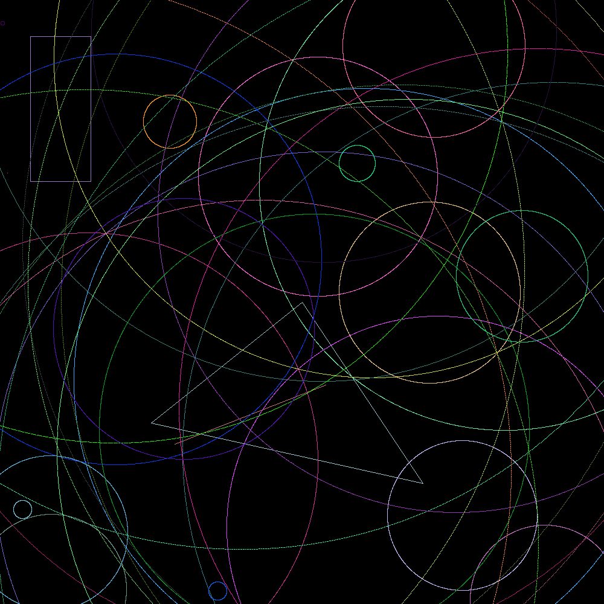

# Rust Drawer

Rust Drawer creates a 1000 × 1000 PNG with a random line, a single point, a rectangle, a triangle, and 49 circles. The rectangle and triangle stay in the same positions on every run. The other shapes are placed randomly, and each draw chooses a random RGB color.



## Run the example

From the project directory, use Cargo with a Rust toolchain that supports the 2024 edition.

```sh
cargo run
```

Open `image.png` in an image viewer. The program writes the file in the current working directory and replaces it on each run. Some circles appear as arcs because their outlines extend beyond the canvas.

## Draw your own shapes

The origin is the upper-left pixel. Increasing `x` moves right, and increasing `y` moves down. To try this example, replace the drawing statements between `Image::blank` and `raster::save` in [src/main.rs](src/main.rs). Keep its imports and the `Displayable` implementation.

```rust
let a = gs::Point::new(40, 60);
let b = gs::Point::new(180, 140);
let c = gs::Point::new(220, 40);

gs::Rectangle::new(&b, &a).draw(&mut image); // Opposite corners in either order
gs::Triangle::new(&a, &b, &c).draw(&mut image);
gs::Line::new(&a, &b).draw(&mut image);
gs::Circle::new(&c, 25).draw(&mut image);
a.draw(&mut image);
```

For random placement, pass the canvas width first and height second.

```rust
gs::Point::random(image.width, image.height).draw(&mut image);
gs::Line::random(image.width, image.height).draw(&mut image);
gs::Circle::random(image.width, image.height).draw(&mut image);
```

Random points, line endpoints, and circle centers use coordinates in `0..width` and `0..height`. Random circles choose a radius in `1..width`, so they require a width of at least two pixels. All three functions require positive dimensions.

## How rendering works

[src/geometrical_shapes.rs](src/geometrical_shapes.rs) defines every shape and both traits. Each shape implements `Drawable`, with `draw` to render it and `color` to pick a color. A triangle or rectangle picks one color for its entire outline. Separate shapes can occasionally pick the same color.

Lines use Bresenham’s algorithm to visit pixels from the first endpoint through the last. Triangles join three line segments, and rectangles join four. Circles sample their circumference every 0.1 degrees. The `Displayable` implementation for `raster::Image` checks coordinates before writing each pixel, so shapes can extend past the image edges.

[Cargo.toml](Cargo.toml) declares `raster` for pixel storage and PNG output, and `rand` for random coordinates, radii, and colors.

## Run the tests

```sh
cargo test
```

The five unit tests in the shape module check random point coordinates, both endpoints of random lines, random circle centers, the four corners of a rectangle constructed in reverse order, and the endpoint values of a line with coincident points. To run just the reversed-corners example, use `cargo test test_rectangle_reversed`.
